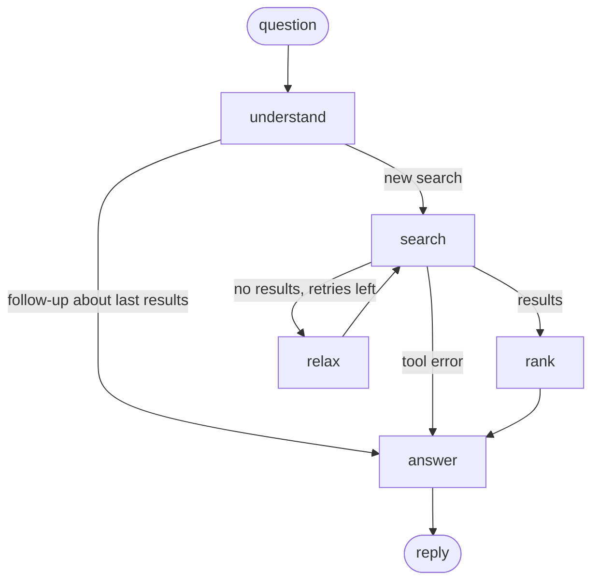

# Gmaps Agent

A small AI agent that finds places on Google Maps through an MCP server.

```
You: suggest a 4.5 or above rated restaurant near me which is open
  [understand] {'query': 'restaurant', 'location': '', 'min_rating': 4.5, 'open_now': True, 'max_results': 5}
  [search] 5 result(s) for 'restaurant near Boston, MA'
  [rank] top: [...]

Agent: Here are open restaurants rated 4.5+ near you:
1. ... ⭐ 4.7 (1,240 reviews), 123 Main St, https://maps.google.com/?cid=...

You: which of those has the most reviews?
  [understand] follow-up about the previous results, no new search
```

It works for any kind of place: restaurants, coffee shops, laundromats, gas stations, pharmacies, gyms and so on.

## How it works

Two programs talk to each other over MCP:

- **`maps_server.py`** is an **MCP server**. It offers one tool, `search_places(query, location, min_rating, open_now, max_results)`, which calls the Google Places API and returns a tidy list. Only this file uses your Google key.
- **`agent.py`** is a **LangGraph agent**. It starts the server, and each question runs through a graph of steps (nodes):



| Node | Uses | Job |
|---|---|---|
| `understand` | model (structured output) | Turn the question into search filters; spot follow-ups that need no new search |
| `search` | MCP tool | Call `search_places` on the server |
| `relax` | code | No results? Lower the rating by 0.5, then drop "open now" (max 2 retries) |
| `rank` | code | Sort by a Bayesian average, so a 5.0 from 3 reviews doesn't beat a 4.7 from 2,000 |
| `answer` | model | Write the reply from the ranked places, mentioning any relaxed filter |

All nodes share one **state** (question, filters, places, notes, history). A **checkpointer** saves it after every step, so follow-up questions ("which of those...", "same but in Cambridge") can use the previous results.

## Setup

### 1. Get API keys
- **OpenAI:** https://platform.openai.com/api-keys
- **Google Maps:** in [Google Cloud Console](https://console.cloud.google.com/), create a project with billing enabled, then:
  1. Enable **Places API (New)** under *APIs & Services → Library*.
  2. Create an API key under *APIs & Services → Credentials*.
  3. Recommended: restrict the key to the Places API (New) only.

### 2. Install
```bash
cd gmaps
python3 -m venv .venv
source .venv/bin/activate
pip install -r requirements.txt
```

### 3. Configure
```bash
cp .env.example .env
```
Open `.env` and fill in `OPENAI_API_KEY`, `GOOGLE_MAPS_API_KEY`, and `MY_LOCATION` (your city or address, used for "near me"). `.env` is listed in `.gitignore`, so it's never committed.

## Run
```bash
python agent.py
```

Try asking:
- `suggest a 4.5 or above rated restaurant near me which is open`: the normal path
- `5 star laundromat open right now`: likely triggers `relax`
- `which of those has the most reviews?`: a follow-up, answered without a new search
- `same but in Cambridge`: reuses the previous filters with a new location
- `24 hour pharmacy near me`

Each node prints a line (`[understand]`, `[search]`, `[relax]`, ...) so you can watch the graph run. Type `quit` to exit (or Ctrl+C).

To print the graph as a Mermaid diagram (paste it into https://mermaid.live to see it):
```bash
python agent.py --graph
```

## Test the server on its own (optional)

The [MCP Inspector](https://github.com/modelcontextprotocol/inspector) lets you call the tool by hand, with no model involved:
```bash
npx @modelcontextprotocol/inspector .venv/bin/python maps_server.py
```

## Files

| File | Purpose |
|---|---|
| `maps_server.py` | MCP server exposing the `search_places` tool |
| `agent.py` | LangGraph agent: MCP client + graph of nodes + conversation memory |
| `requirements.txt` | Python dependencies (MCP SDK v2, OpenAI, httpx, python-dotenv, LangGraph) |
| `.env.example` | Template for API keys and settings |
| `.gitignore` | Keeps `.env` and local files out of git |

## Troubleshooting

| Problem | Fix |
|---|---|
| `Google Places API error 403 ... not been used ... or it is disabled` | Enable **Places API (New)** for your project (the older "Places API" isn't the same one). |
| `Google Places API error 400 ... API key not valid` | Check `GOOGLE_MAPS_API_KEY` in `.env`. |
| `OPENAI_API_KEY is not set` | Create `.env` from `.env.example`. |
| `RateLimitError ... insufficient_quota` | Your OpenAI account has no credits. Add some under Billing on platform.openai.com (separate from ChatGPT Plus). |
| `No module named 'langgraph'` | Re-run `pip install -r requirements.txt` inside the virtual environment. |
| Results are from the wrong area | Set `MY_LOCATION` more precisely (an address works best), or name a place in your question. |
| `No module named 'mcp.server.fastmcp'` in other tutorials | This project uses MCP SDK v2, where `FastMCP` became `MCPServer`. |

## Ideas for next steps
- Add a `get_directions` tool (Routes API) and a node that adds walking time to each result.
- Group meetups: take several people's locations and find a place that's fair for everyone.
- Add a human-approval step (LangGraph interrupts) before an action like saving to a calendar.
- Swap `InMemorySaver` for a SQLite checkpointer so conversations survive restarts.
- Connect `maps_server.py` to an MCP client app such as Claude Desktop.
